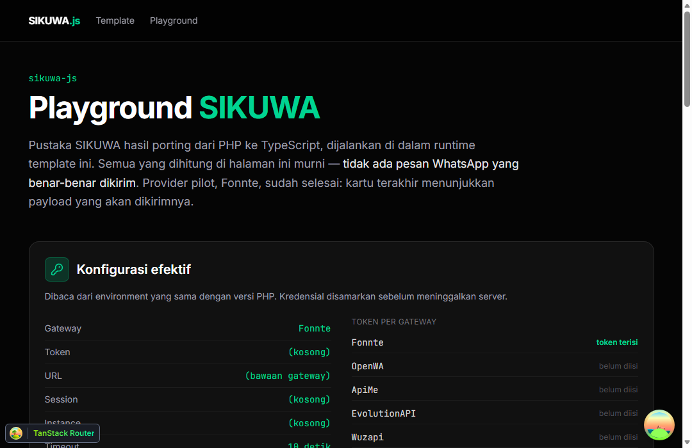
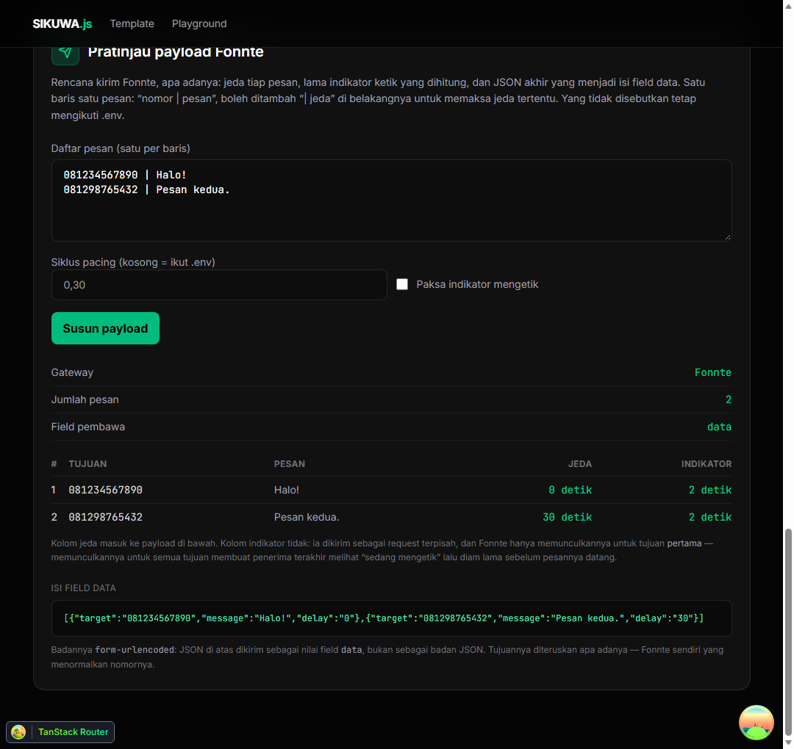

<div align="center">

# sikuwa

**SDK multi-gateway WhatsApp untuk JavaScript/TypeScript** — satu antarmuka untuk
tujuh gateway, porting dari paket PHP
[`mdestafadilah/sikuwa`](https://github.com/mdestafadilah/sikuwa).

**Tanpa dependensi runtime.** Seluruh gateway hanya REST + JSON, jadi `fetch`
bawaan Node 18+, Bun, Cloudflare Workers, dan peramban sudah cukup.

[](https://www.npmjs.com/package/sikuwa)
[](LICENSE)
[](https://www.typescriptlang.org/)



</div>

## Pasang

```bash
npm install sikuwa
# atau
bun add sikuwa
```

Paket ini **ESM saja**. Node 18+ sudah punya `fetch` global yang dibutuhkan;
Node 22.12+ bahkan bisa `require("sikuwa")` dari proyek CommonJS. Tidak ada
dependensi yang ikut terpasang — `npm ls sikuwa` hanya akan menampilkan satu
baris.

## Pakai

Titik masuk yang disarankan adalah `Client` — ia memegang konfigurasi, transport,
dan pemilihan gateway:

```ts
import { Client } from "sikuwa";

const client = new Client({
  provider: "OpenWA",          // atau "auto"
  token: "owa_k1_…",
  url: "http://localhost:2785",
  session: "my-session",
});

await client.send({ destination: "081234567890", message: "Halo dari sikuwa!" });
```

Dengan `provider: "auto"`, gateway diundi di antara yang punya
`WHATSAPP_TOKEN_<Provider>` sendiri — token umum `WHATSAPP_TOKEN` tidak dihitung,
karena ia tidak menunjukkan gateway mana yang siap dipakai. Opsi yang tidak diisi
dibaca dari environment, jadi `new Client()` tanpa argumen pun jalan.

Satu gateway juga bisa dipakai langsung, tanpa lewat `Client`:

```ts
import { Fonnte } from "sikuwa";

// Membaca WHATSAPP_* dari process.env.
const fonnte = new Fonnte();

// Satu pesan.
await fonnte.sendMessage({
  destination: "081234567890",
  message: "Halo dari sikuwa!",
});

// Beberapa sekaligus, dengan jeda yang diatur sendiri.
await fonnte.sendMessage([
  { destination: "081234567890", message: "Pesan pertama." },
  { destination: "081298765432", message: "Pesan kedua.", delay: 30 },
]);
```

Konfigurasi bisa juga diberikan langsung, tanpa environment sama sekali:

```ts
import { Config, Fonnte } from "sikuwa";

const config = new Config({
  tokens: { Fonnte: "token-fonnte" },
  pacing: { cycle: "0,30" },
  typing: { enabled: true },
});

const fonnte = new Fonnte(config);
```

Kunci environment sengaja dipertahankan **persis sama** dengan versi PHP, supaya
berkas `.env` yang sudah ada tetap terbaca:

```dotenv
WHATSAPP_PROVIDER=Fonnte
WHATSAPP_TOKEN_Fonnte=xxxxxxxxxxxx
WHATSAPP_PACING_CYCLE=0,30
WHATSAPP_TYPING=1
WHATSAPP_THROTTLE_MAX=20
WHATSAPP_THROTTLE_WINDOW=60
```

Daftar lengkapnya ada di [`.env.example`](.env.example).

## Memeriksa nomor sebelum mengirim

WhatsApp tidak memberi tahu apakah sebuah nomor bisa dihubungi sebelum pesannya
benar-benar dikirim, dan menembak nomor yang tidak pernah ada adalah pemicu
pemblokiran yang paling sering. `checkNumbers()` menjawabnya lebih dulu:

```ts
const hasil = await client.checkNumbers(["081234567890", "089876543210"]);

hasil.isRegistered("081234567890"); // true
hasil.whatsappId("081234567890");   // "6281234567890@c.us"
hasil.registered();                 // ["081234567890"]
hasil.unregistered();               // ["089876543210"]
```

Nomor boleh ditulis dalam bentuk apa pun (`0812…`, `+62 812…`, `62812…`) — setiap
pencarian menormalkannya lebih dulu. Hasilnya `NumberCheck`, satu bentuk yang
sama untuk ketujuh gateway, jadi berpindah gateway tidak mengubah kode pemanggil.

Bila ingin penyaringannya otomatis, nyalakan `check_numbers`:

```ts
const client = new Client({ provider: "OpenWA", check_numbers: true });

// 089876543210 dibuang sebelum dikirim, dan jumlahnya dilaporkan.
await client.send([
  { destination: "081234567890", message: "Halo" },
  { destination: "089876543210", message: "Halo" },
]);
// "Sukses, messageId: … (1 tujuan dilewati karena tidak terdaftar: 089876543210)"
```

Tiga janji yang dijaga fitur ini:

1. **Mati berarti tidak berubah sama sekali.** Selama `check_numbers` tidak
   dinyalakan, tidak ada satu pun request pemeriksaan yang muncul.
2. **Gagal berarti tetap kirim.** Pemeriksaan yang timeout, atau ditolak karena
   kuncinya tidak berperan operator, tidak pernah menahan pesan.
3. **Hanya yang dipastikan tidak ada yang dibuang.** Nomor yang tidak disebut
   gateway berarti "belum diperiksa", bukan "tidak terdaftar".

## Membagi batch ke beberapa gateway

Mode `auto` mengundi gateway **sekali per panggilan**, jadi satu `send()` berisi
seratus pesan tetap keluar lewat satu gateway saja. Dengan `WHATSAPP_ROTATE`
menyala, batch itu dibagi ke semua gateway yang punya token:

```ts
const client = new Client({
  provider: "auto",
  tokens: { OpenWA: "owa-key", Wuzapi: "wuz-token" },
  urls: { OpenWA: "https://openwa.test", Wuzapi: "https://wuzapi.test" },
  rotate: true,
});

await client.send(seratusPesan);
// "Sukses, 100/100 pesan terkirim lewat 2 gateway (OpenWA 50, Wuzapi 50)"
```

Urutan gateway diundi tiap panggilan, dan pesan dibagikan bergiliran sehingga
jumlahnya berbeda paling banyak satu. Pengaturan tingkat panggilan — `pacing`,
`typing`, `throttle` — ikut ke setiap potongan; tanpa itu potongan kedua dan
seterusnya kembali ke jeda bawaan gateway, tepat di bagian yang paling butuh
dijeda.

Rotasi menuntut `WHATSAPP_PROVIDER=auto`: satu gateway yang dipilih tetap tidak
punya apa pun untuk dibagi, jadi kombinasi itu ditolak sebelum satu pun request
berangkat.

## Logger

SDK ini tidak pernah mencetak apa pun sendiri. Bila ingin melihat kejadian yang
tadinya senyap — indikator "sedang mengetik" yang gagal, percobaan ulang setelah
gateway menolak sementara, tujuan yang dilewati karena tidak terdaftar — pasang
logger:

```ts
const client = new Client({
  provider: "OpenWA",
  logger: {
    log: (level, message, context) => console.log(level, message, context),
  },
});
```

Bentuknya sengaja cuma satu method `log(level, message, context)` — `pino`,
`winston`, dan `console` semuanya bisa dibungkus dengan satu baris, sedangkan
meniru delapan method PSR-3 berarti memaksa setiap logger buatan pemanggil
menulis method yang tidak pernah dipanggil.

**Logger tidak pernah bisa menggagalkan pengiriman.** Logger yang melempar —
karena disk penuh, atau konteksnya tidak sesuai harapannya — ditelan diam-diam,
karena kegagalan hiasan tidak boleh berubah menjadi kegagalan pesan.

## Beberapa session untuk satu gateway

`WHATSAPP_SESSION` dan `WHATSAPP_INSTANCE` masih berlaku seperti sebelumnya.
Bila satu gateway punya beberapa session, tuliskan sebagai daftar berpisah koma:

```dotenv
WHATSAPP_SESSIONS_OpenWA=sess-1,sess-2
WHATSAPP_INSTANCES_EvolutionAPI=inst-1,inst-2
```

Urutannya menentukan mana yang dipakai lebih dulu; nilai tunggal
(`WHATSAPP_SESSION`, `WHATSAPP_SESSION_<Provider>`) tetap menang bila diisi.

## Gateway yang didukung

| Gateway | Jenis | Basis | Tautan |
| --- | --- | --- | --- |
| Fonnte | Berbayar (cloud) | — | <https://fonnte.com/> |
| OpenWA | Self-hosted | Node.js | <https://github.com/rmyndharis/OpenWA> |
| ApiMe | Self-hosted | Go / WhatsMeow | <https://github.com/open-apime/apime> |
| Evolution API | Self-hosted | Node.js / Baileys | <https://github.com/evolution-foundation/evolution-api> |
| Wuzapi | Self-hosted | Go / WhatsMeow | <https://github.com/asternic/wuzapi> |
| Wwebjs | Self-hosted | Node.js / whatsapp-web.js | <https://github.com/avoylenko/wwebjs-api> |
| Waxum | Self-hosted | Rust / whatsapp-rust | <https://github.com/imtaqin/waxum> |

Ketujuhnya memakai bentuk pesan yang sama (`destination` + `message`), jadi
mengganti gateway tidak mengubah kode pemanggil. Yang berbeda hanya kredensial,
id sesi, dan kunci `.env`-nya.

## Status porting

Ini **porting, bukan konversi**: paket PHP tetap sumber kebenaran, dan versi npm
adalah implementasi kedua. Karena itu cakupannya bertahap — dan versinya
sengaja dimulai dari `0.1.0`, bukan mengikuti versi paket PHP, supaya tidak
terkesan sudah setara padahal belum.

| Lapisan | Status |
| --- | --- |
| Support (Pacing, Throttle, Typing, Presence, PhoneNumber, Text, File, Envelope, Qr) | selesai |
| Support (Rotation, Log, NumberCheck) | selesai |
| Exceptions (14 kelas), Config, Session, Contracts | selesai |
| Http (HttpResponse, HttpExecutor berbasis `fetch`) | selesai |
| AbstractProvider (plan, retry, pacing, typing, logger, pemeriksaan nomor) | selesai |
| **Fonnte**, **OpenWA**, **ApiMe**, **EvolutionAPI**, **Wuzapi**, **Wwebjs**, **Waxum** | **selesai** |
| Client (registri provider, pemilihan `auto`, `notify()`, `checkNumbers()`, rotasi batch) | selesai |

Seluruh lapisan versi PHP — sampai `0.12.0` — sudah diporting. Yang belum ada
hanyalah hal-hal yang memang tidak dibawa dari sana — mis. integrasi framework
CodeIgniter/Laravel, karena SDK ini sengaja tidak terikat framework.

## Perbedaan yang disengaja dari versi PHP

- **Setiap panggilan jaringan mengembalikan `Promise`.** PHP memblokir di dalam
  pemanggilan; JavaScript tidak bisa.
- **`File.bytes()` mengembalikan `Uint8Array`**, bukan string biner — bentuk
  yang memang diminta `Blob`/`FormData` di jalur unggah.
- **Accessor konfigurasi provider bernama `settings()`, bukan `config()`.** PHP
  membedakan properti `$this->config` dari method `$this->config()`; JavaScript
  tidak bisa, dan properti `config` dipertahankan apa adanya karena setiap
  provider membacanya jauh lebih sering.
- **`Client::config()` dan `Client::http()` menjadi properti `client.config` dan
  `client.http`.** Sebabnya sama; di sini tidak ada nama yang bergeser, hanya
  bentuk pemanggilannya.
- **Logger adalah satu method `log()`, bukan delapan method PSR-3.** Yang dipakai
  SDK hanya `log(level, message, context)`, dan itu yang dimiliki semua pustaka
  logger JavaScript. Menyalin kedelapan method berarti memaksa setiap logger
  buatan pemanggil menulis tujuh method yang tidak pernah dipanggil.

Selain lima itu, perilakunya dijaga setia — termasuk detail semantik PHP yang
mudah terlewat (`is_numeric(true) === false`, `"0"` dianggap salah oleh
`filter_var`, `rtrim($url, '/')` membuang semua garis miring, dan seterusnya).

## Pengembangan

```bash
bun install
bun test              # 574 tes paritas + integrasi
bun run typecheck     # app, worker, dan pustaka
bun run build:lib     # keluaran npm ke dist-lib/
bun run verify:package
bun run dev           # playground di http://localhost:5173
```

Paritas perilaku dibuktikan lewat tes, bukan diklaim: berkas PHPUnit di repo PHP
diterjemahkan menjadi `tests/sikuwa/**/*.test.ts`. Fonnte juga diuji terhadap
server HTTP sungguhan (`fonnte-live.test.ts`) — klien tiruan tidak bisa
membuktikan bahwa `URLSearchParams`, `boundary` multipart, dan byte berkas
benar-benar utuh setelah melewati `fetch` bawaan.

### Merilis

Rilis berjalan dari GitHub, bukan dari laptop:

```bash
# 1. Naikkan versi di package.json, commit, push.
# 2. Buat GitHub Release dengan tag v<versi> — mis. v0.1.8.
```

`.github/workflows/publish.yml` yang menerbitkan: ia memeriksa bahwa tag cocok
dengan `package.json`, memastikan versinya belum ada di registry, lalu
menjalankan `npm publish`. Tidak ada token npm yang disimpan di repo — npm
memakai **trusted publishing (OIDC)** lewat `id-token: write`, dan provenance
dibuat otomatis.

`prepublishOnly` tetap berlaku di sana, jadi tes, build, dan `verify:package`
tidak bisa dilewati dari jalur mana pun.

Menerbitkan dari mesin sendiri masih bisa (`npm publish`), tetapi registry kini
menuntut 2FA untuk publikasi: akun harus punya 2FA aktif, atau memakai token
granular dengan **Bypass 2FA** menyala. Kalau keduanya tidak ada, jalur lokal
akan gagal dengan 403 meski izin paketnya sudah `read-write`.

### Playground

`src/api/whatsapp/` + `src/routes/whatsapp.tsx` menyediakan halaman untuk
memeriksa konfigurasi, perhitungan pacing/typing/throttle, dan **payload yang
akan dikirim** — semuanya tanpa mengirim satu pesan pun. Pratinjau payload
memakai klien HTTP yang sengaja selalu gagal, jadi kalau jalur itu tanpa sengaja
menyentuh jaringan, halamannya gagal alih-alih benar-benar menembak gateway.



### Struktur

```
src/lib/sikuwa/          pustaka (tanpa dependensi runtime)
  internal/scalar.ts     semantik tipe longgar PHP (is_numeric, FILTER_VALIDATE_BOOLEAN, …)
  support/               modul murni: pacing, throttle, typing, presence, file, rotation, log, …
  http/                  transport berbasis fetch yang bisa disuntik
  exceptions/            seluruh kelas exception
  config.ts, session.ts, number-check.ts
  contracts/whatsapp.ts  antarmuka yang harus dipenuhi setiap gateway
  providers/             AbstractProvider + tujuh gateway (fonnte/, openwa/, apime/, …)
  index.ts               permukaan publik
src/api/whatsapp/        playground Hono (service → controller → route)
src/routes/whatsapp.tsx  halaman playground
tests/sikuwa/            suite tes paritas
scripts/build-lib.mjs    build paket npm (tsc + ekstensi .js)
```

---

Repositori ini dibangun di atas **BHVR Template** (Bun + Hono + Vite + React +
Cloudflare Workers). Dokumentasi template-nya ada di
[BHVR-TEMPLATE.md](BHVR-TEMPLATE.md).
